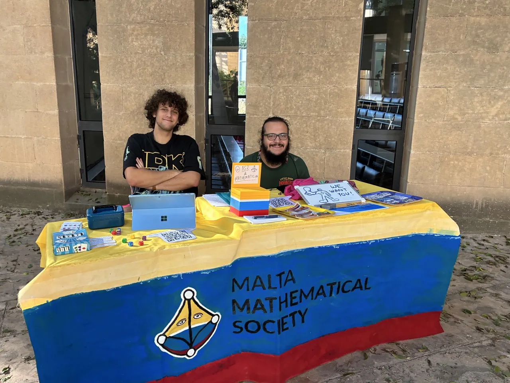
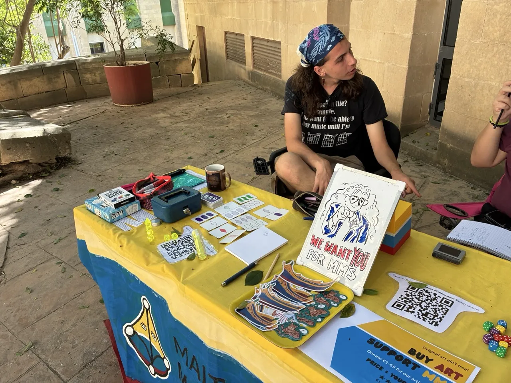
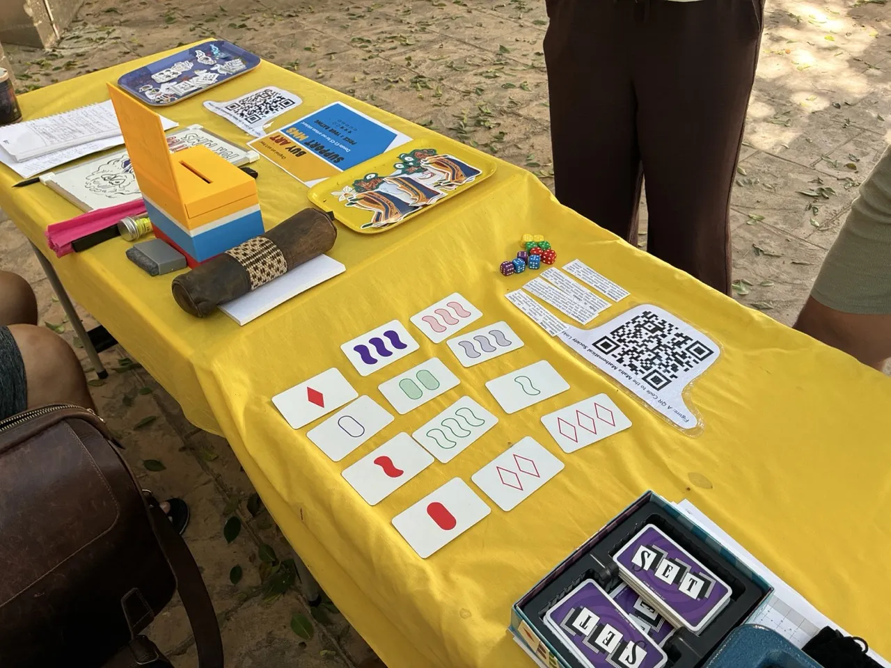
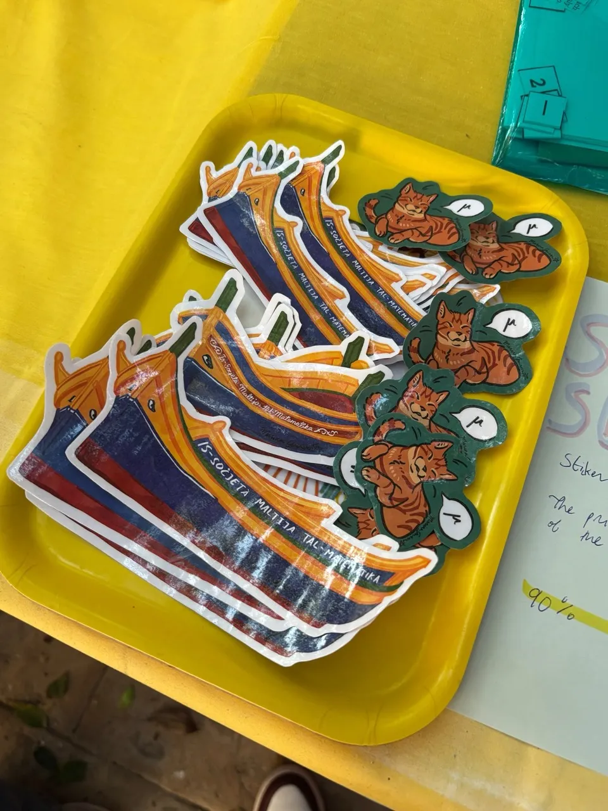
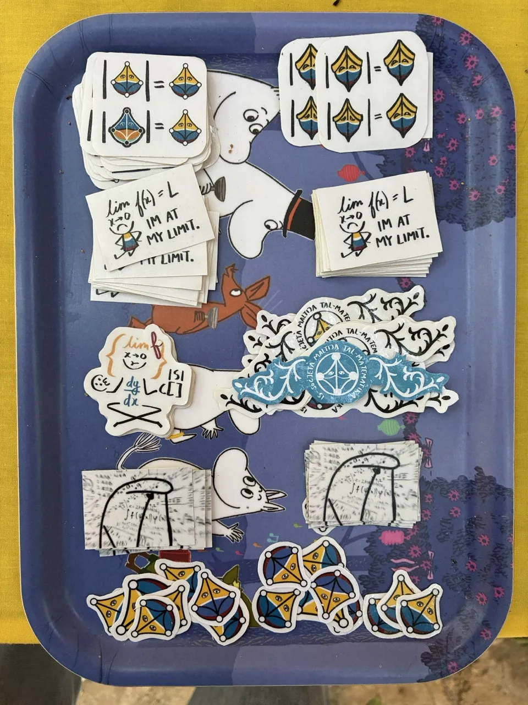
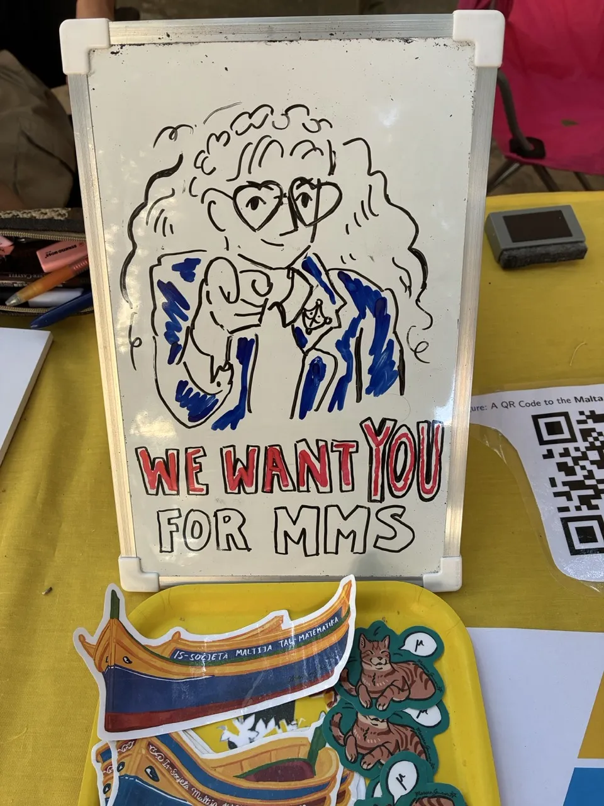

This week the MMS executive got to hang out with each other and with S-cubed (by that I mean Gabriel). We got permission from the Maths department to share the SLT space with S-cubed, and to honor this good spirit we also organized a membership bundle-deal.

Louie, Maggie, Gabriel and Daneil managed to paint an impressive banner/tablecloth for the stand, and it would absolutely not have been the same without it.





We had stickers, an ask box (where no asks were submitted ;-;), and our games/activities, which got a generous amount of attention: Sets, the Dice, and that Proofs game. These shall definitely feature at our Freshers Social. As for sets, one of us came up with printing a colorblind version, and also to pit professors against each other in a Sets tournament. 

Now let me talk stickers...





Wild success. I must've cut out at least 100. The stickers cost under 10 euro to make: sticker paper from Liliana, printing services from Daniel, and 4m x0.5m self-adhesive lamination paper for EUR6, and the design and assembly by Marina. Members are bestowed a luzzu boat and the cat, or one could donate a few euro. 

I ahall update the blog on how well we did with memberships. Speaking of...

That's right, sign up! And you could help me write blogs in markdown like a hacker!

Looking forward to see many faces from frashers week at the Freshers Social. We are working hard towards it.

- Marina