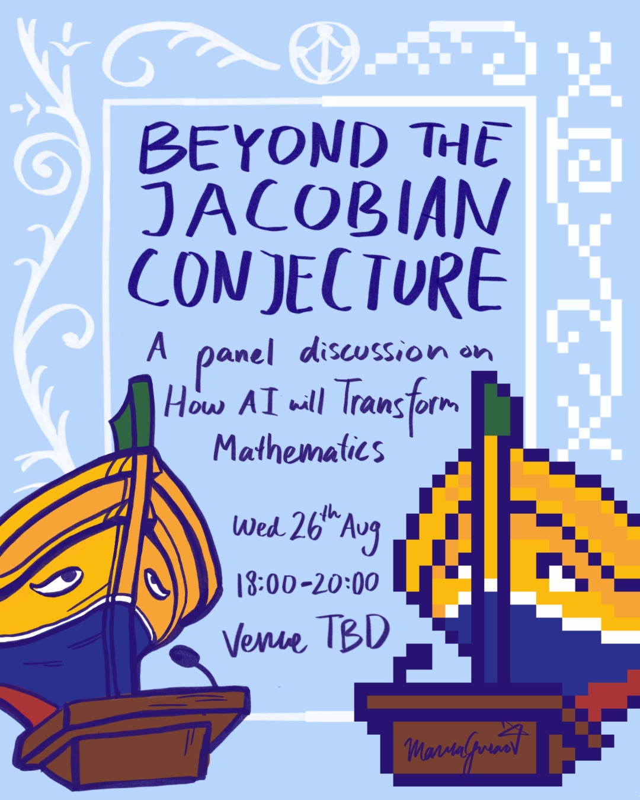
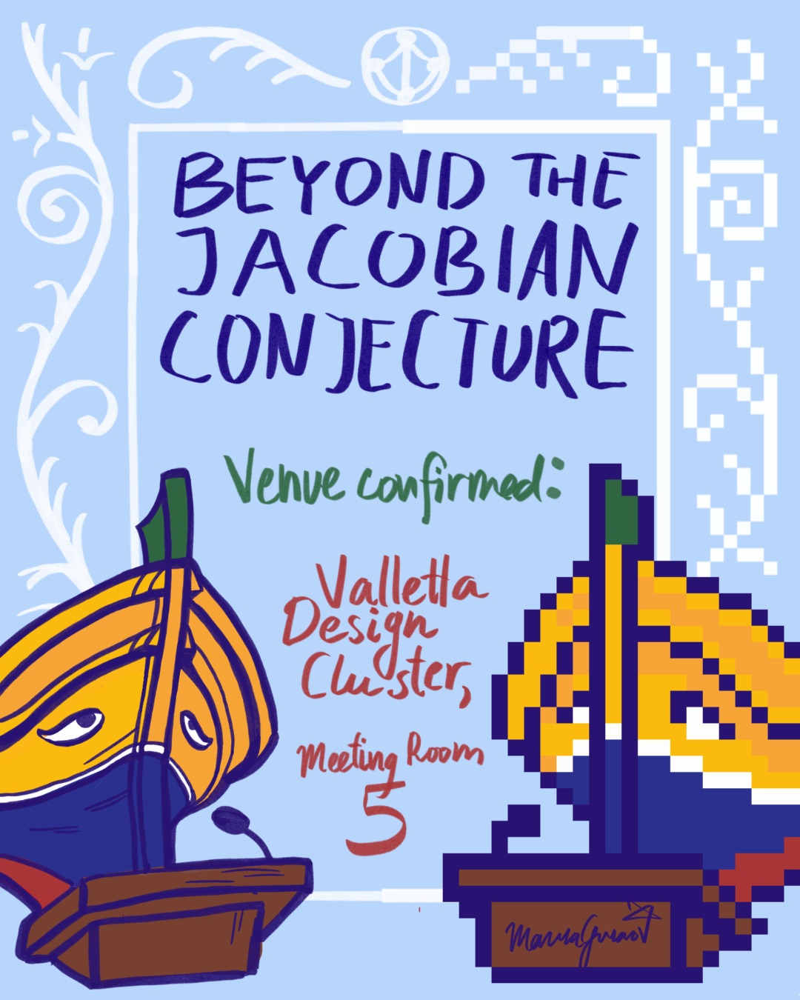
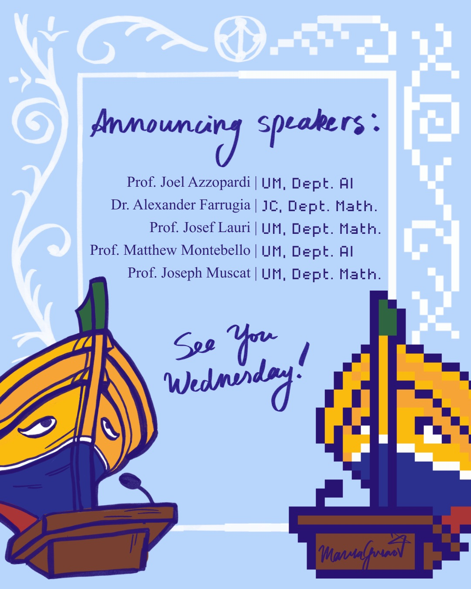

_Beyond the Jacobian Conjecture_ (Lil hinn mill-_Jacobian Conjecture_) kienet diskussjoni dwar l-użu tal-intelliġenza artifiċjali fil-matematika. Il-membri tal-panel kienu l-Prof. Joel Azzopardi, Dr Alexander Farrugia, il-Prof. Josef Lauri u l-Prof. Joseph Muscat. Id-diskussjoni ġiet immoderata minn Louie Cotter.

Din l-attività saret fid-dawl tal-iżviluppi reċenti fejn mudelli tal-lingwa (LLMs) bdew jipproduċu provi għal problemi matematiċi qodma, b’mod notevoli l-kontroeżempju ġġenerat minn grupp ta’ aġenti tal-IA għall-Jacobian Conjecture




